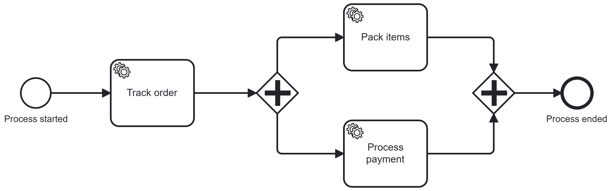

# Camunda 8 - Develop Workers (Java) - Lab

Lab project for the **[Camunda 8 - Develop Workers (Java)](https://academy.camunda.com/c8-develop-workers-java/)** course on Camunda Academy.

This course gives a detailed hands-on experience on developing workers using Camunda. During the course, you will review basic and advanced job worker configurations — including timeout and variable fetching — to better understand how they work and how to optimize your project.

> **Difficulty:** Intermediate | **Time:** ~1h 30min | **Platform:** Camunda 8.10+

## What you will learn

- Describe how Job Workers implement business logic in Camunda
- Recognize and configure job activation settings: **Timeout**, **FetchVariables**
- Implement, run, and test timeout and variable-fetching behavior
- Recognize configuration and errors when completing and failing jobs
- Implement output variables on job completion

## Overview

The **Order Process** (`orderProcess`) is a BPMN process with three service tasks executed by Java job workers:



| Job Type | Worker Class | Description |
|---|---|---|
| `trackOrderStatus` | `OrderHandler` | Tracks the order status (simulates a 10-second delay) |
| `packItems` | `PackItemsHandler` | Handles item packaging |
| `processPayment` | `ProcessPaymentWorker` | Processes the payment and returns a confirmation ID |

## Prerequisites

### Knowledge
- Awareness of Camunda and Job Workers
- Competent with BPMN and Java

Recommended preparatory courses:
- [Camunda - Technical Overview](https://academy.camunda.com/c8-technical-overview)
- [Camunda - Develop your first job worker (Java)](https://academy.camunda.com/c8-develop-first-worker-java)
- [Camunda - Error Handling](https://academy.camunda.com/c8-error-handling)

### Tools & Access
- Java 21+
- Maven 3.x
- An IDE (Eclipse, IntelliJ, or VS Code)
- A [Camunda 8 SaaS account](https://academy.camunda.com/c8-h2-create-account) with a running [cluster](https://academy.camunda.com/c8-h2-create-cluster) and [client credentials](https://academy.camunda.com/c8-h2-create-client-credentials)

## Configuration

For Camunda 8.10, configure the Java client with the `CAMUNDA_*` environment variables. The client reads these variables when `CamundaClient.newClientBuilder().build()` is called. Set the values for your cluster before running:

| Variable | Description |
|---|---|
| `CAMUNDA_GRPC_ADDRESS` | Zeebe gRPC endpoint as an absolute URI (for example, `https://...:443`) |
| `CAMUNDA_REST_ADDRESS` | Orchestration Cluster REST endpoint as an absolute URI |
| `CAMUNDA_OAUTH_URL` | OAuth token URL |
| `CAMUNDA_TOKEN_AUDIENCE` | OAuth token audience (commonly `zeebe.camunda.io`) |
| `CAMUNDA_CLIENT_ID` | OAuth client ID |
| `CAMUNDA_CLIENT_SECRET` | OAuth client secret |

Use the endpoints and OAuth credentials provided for your Camunda cluster. Addresses must include a URI scheme such as `https://`. The Java client uses REST by default; configure the gRPC address when using gRPC.

If your environment already defines `ZEEBE_REST_ADDRESS`, map it to the variable expected by the Camunda Java Client before launching:

```sh
export CAMUNDA_REST_ADDRESS="$ZEEBE_REST_ADDRESS"
```

When running from VS Code, make sure the `CAMUNDA_*` variables are available to the Java run/debug process, not only to a separate terminal session. The 8.10 client does not use `ZEEBE_REST_ADDRESS` as a substitute for `CAMUNDA_REST_ADDRESS`.

## Build

```bash
mvn clean package
```

## Run

```bash
mvn exec:java -Dexec.mainClass="com.camunda.academy.OrderApplication"
```

> **Before running:** deploy `src/main/resources/order.bpmn` to your cluster using Camunda Modeler or the Web Modeler.

The application will:
1. Create one process instance with randomized order variables (product name, price, promotion code, etc.).
2. Start three job workers that poll for and complete jobs of types `trackOrderStatus`, `packItems`, and `processPayment`.
3. Wait for user input — press any integer and **Enter** to shut down the workers gracefully.

## Project Structure

```
src/main/java/com/camunda/academy/
├── OrderApplication.java          # Entry point — creates client, instances, and workers
├── FakeRandomizer.java            # Generates random order variables using JavaFaker
├── handler/
│   ├── OrderHandler.java          # Job handler for trackOrderStatus
│   ├── PackItemsHandler.java      # Job handler for packItems
│   └── ProcessPaymentHandler.java # Job handler for processPayment
└── services/
    └── TrackingOrderService.java  # Business logic called by all handlers
src/main/resources/
└── order.bpmn                     # BPMN process definition
```

## Dependencies

| Library | Version | Purpose |
|---|---|---|
| `io.camunda:camunda-client-java` | 8.10.6 | Camunda 8 Java client |
| `com.github.javafaker:javafaker` | 1.0.2 | Random test data generation |
| `org.slf4j:slf4j-simple` | 2.0.17 | Logging |

The project uses Camunda Java client 8.10.6, and the project builds successfully against this version.
